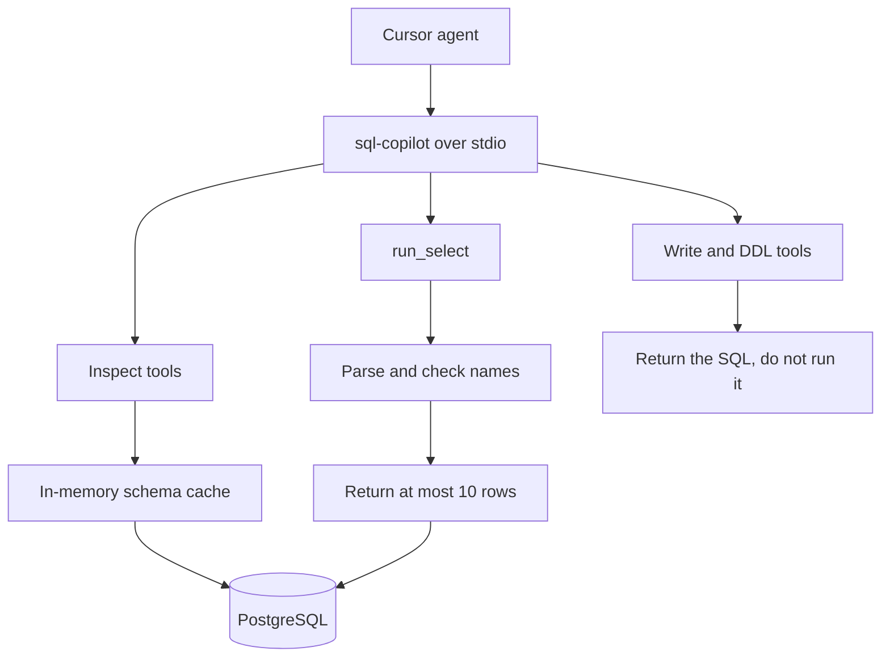

# sql-copilot

A local [MCP](https://modelcontextprotocol.io) server for PostgreSQL. Cursor starts it as a subprocess. The model calls named tools. The server returns JSON. Nothing listens on a port.

Reads are limited on purpose. A `SELECT` returns at most 10 rows, plus the SQL to run locally for a larger result. `INSERT`, `UPDATE`, `DELETE`, and DDL are not executed. The server returns the statement so a person can run it in their own SQL client.

Arguments, result shapes, and a clone-and-test checklist are in the [tool spec](docs/tools.md).

## Tools

Inspect (`src/sql_mcp/tools/inspect.py`) reads the database structure and does not run application SQL.

| Tool | What the model gets back |
| --- | --- |
| `ping_connection` | Whether PostgreSQL is reachable |
| `get_schema` | Cached public tables, columns, and keys |
| `get_table_info` | One table, including a row estimate and indexes |
| `prepare_query_context` | Tables and join paths for an English question. No SQL |

Execute (`src/sql_mcp/tools/execute.py`) is the only place SQL is accepted.

| Tool | What it does |
| --- | --- |
| `run_select` | Runs a `SELECT`. Returns at most 10 rows and `sql_to_run_locally` |
| `validate_query` | Classifies a statement and does not run it |
| `dry_run`, `run_mutation`, `alter_table_safe` | Return the write or DDL unchanged. They do not run it |
| `refresh_schema` | Reloads the in-memory schema cache |
| `get_logs` | Recent audit lines. `SELECT` results are not stored |
| `get_status` | Connection, cache age, and the last mutation record |

## Setup

Requires Python 3.11+, [uv](https://docs.astral.sh/uv/), and PostgreSQL. Query examples use the open-source DVD Rental sample. Download and restore steps are in the [tool spec](docs/tools.md).

```text
uv sync
copy .env.example .env
```

Set `DB_URL` in `.env`. In `.cursor/mcp.json`, set `cwd` to your clone path. `PYTHONPATH` stays `src`.

```text
uv run python -m sql_mcp.server
```

## Design



Each tool is a function registered on a FastMCP server. Cursor speaks to that process over stdio.

`schema.py` loads the public schema once at startup and serves it from memory, so later turns do not re-query the catalog. `validator.py` parses SQL with sqlglot before any statement can run: one statement only, names checked against the cache, and a 10-row cap on `SELECT`. Writes never reach the database. `logger.py` appends one JSON line per call and omits `SELECT` row data.

Every database call borrows a connection from a small pool and returns it.

## Roadmap

Package the same stdio server as a Docker image so Cursor can start it with `docker run -i` without a local Python install. The container would still be an MCP process, not a web service.
