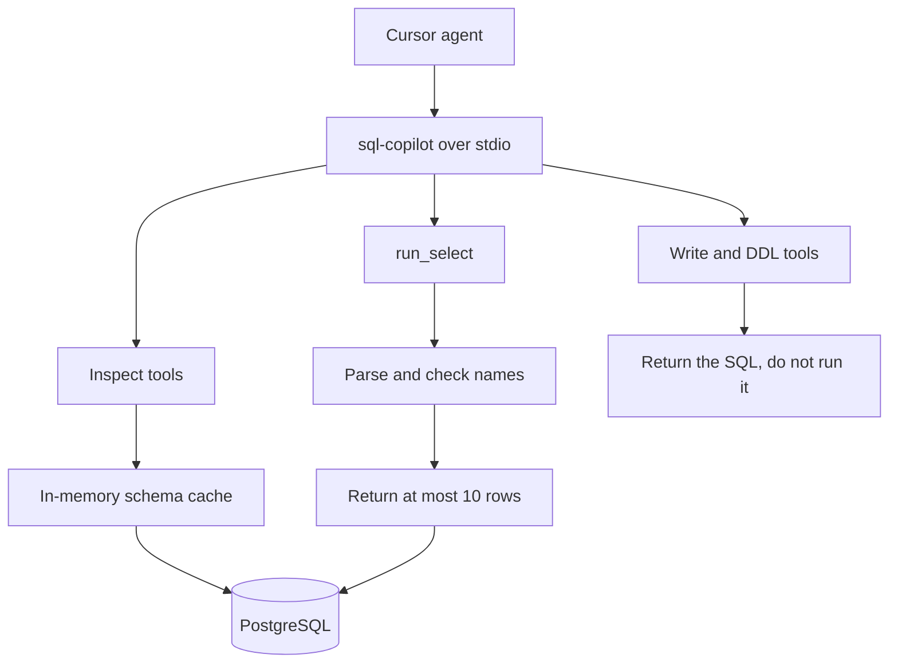

# sql-copilot

A local [MCP](https://modelcontextprotocol.io) server for PostgreSQL. An MCP client such as Cursor or Codex starts it as a subprocess. The model calls named tools, and the server returns results over stdio. It does not open a network port.

`run_select` returns at most 10 preview rows and SQL you can run in your own SQL client. Direct `INSERT`, `UPDATE`, `DELETE`, and DDL statements are returned without being run. A `SELECT` does run in PostgreSQL, so use a database account with read-only access.

Arguments, result shapes, and a clone-and-test checklist are in the [tool spec](docs/tools.md).

## Tools

Inspect (`src/sql_mcp/tools/inspect.py`) reads the database structure and does not run application SQL.

| Tool | What the model gets back |
| --- | --- |
| `ping_connection` | Whether PostgreSQL is reachable |
| `get_schema` | Cached public tables, columns, and keys |
| `get_table_info` | One table, including a row estimate and indexes |
| `prepare_query_context` | Tables and join paths for an English question. No SQL |

Execute (`src/sql_mcp/tools/execute.py`) is the only place SQL is accepted.

| Tool | What it does |
| --- | --- |
| `run_select` | Runs a `SELECT`. Returns at most 10 rows and `sql_to_run_locally` |
| `validate_query` | Classifies a statement and does not run it |
| `dry_run`, `run_mutation`, `alter_table_safe` | Return the write or DDL unchanged. They do not run it |
| `refresh_schema` | Reloads the in-memory schema cache |
| `get_logs` | Recent audit lines. `SELECT` results are not stored |
| `get_status` | Connection, cache age, and the latest recorded INSERT, UPDATE, or DELETE request |

## Setup

Requires Python 3.11+, [uv](https://docs.astral.sh/uv/), and PostgreSQL. Query examples use the open-source DVD Rental sample. Download and restore steps are in the [tool spec](docs/tools.md).

```text
uv sync
copy .env.example .env
```

Set `DB_URL` in `.env`. Copy `.cursor/mcp.example.json` to `.cursor/mcp.json`, then replace `cwd` with the folder where you cloned this project. Keep `PYTHONPATH` as `src`.

```text
uv run python -m sql_mcp.server
```

Run the automated safety check from the repository root:

```text
uv run python -m unittest discover -s tests -v
```

This check confirms that the SQL validator notices a `DELETE` hidden inside a `SELECT`. It does not need a running database.

## Design



Each tool is a function registered on a FastMCP server. The MCP client speaks to that process over stdio.

`schema.py` loads the public schema once at startup and serves it from memory. `validator.py` checks SQL before a preview runs and caps the result at 10 rows. Write tools do not run write statements. `logger.py` appends one JSON line per call and does not store `SELECT` result rows.

Every database call borrows a connection from a small pool and returns it.

## Current limits

- Write statements are refused, including recognized writes hidden inside a `SELECT`. A warning is added for `UPDATE` or `DELETE` with no filter or an always-true filter. The server does not check every PostgreSQL function called by a `SELECT`; a read-only database account reduces risk but is not a complete safeguard.
- Schema checks use cached table and column names. They do not verify schema qualifiers and may miss table aliases or unclear column names.
- One automated check covers a `DELETE` hidden inside a `SELECT`. The setup guide also has manual checks for connecting to PostgreSQL.

## Roadmap

Package the same stdio server as a Docker image so Cursor can start it with `docker run -i` without a local Python install. The container would still be an MCP process, not a web service.
